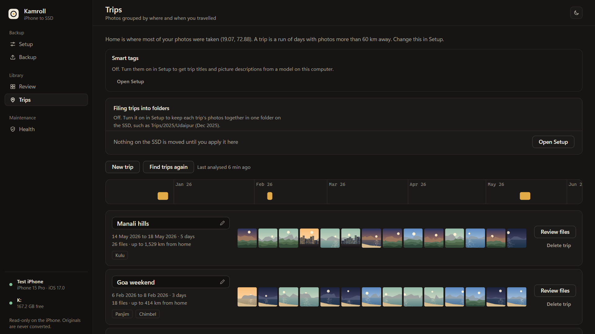

# Kamroll

Back up your iPhone's photos and videos to an external SSD at **original quality**, on Windows and macOS. Crash-safe, resumable and verifiable. Kamroll also sorts what it copied into dated folders, finds your trips from the location saved in your photos, and can file each trip into its own folder.

> Kamroll is an independent open-source project. It is not affiliated with or endorsed by Apple. "iPhone" is a trademark of Apple Inc.



- **Originals, untouched.** Files are copied byte for byte over USB. No conversion, so EXIF and GPS, Live Photo clips and `.AAE` edit files all survive. The iPhone is only ever read.
- **Fault tolerant.** Each file is written to a temporary file, checked, then renamed into place. Pull the cable or the power and the next run resumes where it stopped. Every copy has a SHA-256 fingerprint you can re-check.
- **Proves it matches.** A Health screen compares the phone with the SSD and can re-read every file to catch silent damage. Problems can be queued to be copied again.
- **Organised by when and where.** Dates come from the photo or video itself. Trips come from GPS, with offline place names. You can rename, add to, take from, create and delete trips, and optionally file each trip into `Trips/<year>/<name> (<month year>)/`. Find trips again after a backup: a trip you have named keeps its name, picks up new photos from its days, and absorbs later photos from the same place (within 14 days and 50 km) instead of showing a second trip; a visit weeks later stays its own trip.
- **Tags, no cloud.** Simple rules tag memories, trips, screenshots, chat images, duplicates and junk, with the reasons shown. An optional local [Ollama](https://ollama.com) model can suggest trip titles, and describe pictures if you give it a vision model.
- **Private.** Nothing leaves your computer and there is no telemetry. The app has no web server and opens no network port: the engine runs inside the app.
- **Small.** The whole app is a few megabytes. The engine is written in Rust.

## Install

Download the installer for your system from the [Releases](../../releases) page (the first release is being prepared; until then, build it yourself as below).

- **Windows:** run `Kamroll_x.y.z_x64-setup.exe`. Install **Apple Devices** from the Microsoft Store (or iTunes) so Windows can talk to the iPhone.
- **macOS:** open the `.dmg` and drag Kamroll to Applications. Nothing else to install. Until the app is notarized, macOS asks you to approve it once: System Settings, Privacy & Security, "Open Anyway".

Format the SSD **exFAT** to use it on both. Plug in the iPhone, unlock it and tap **Trust**, pick the SSD in Setup, and press Start backup.

## Build it yourself

You need [Rust](https://rustup.rs) (stable), Node 22, and on Windows the Visual Studio C++ build tools.

```powershell
cd desktop
npm install
npm run build:win                           # or build:mac on a Mac
```

That one build compiles the engine into the app. To work on it, run `npm run dev` in `desktop/` for the app window. For quick UI work the engine can also serve the screens to a browser, on this computer only; that development server is left out of the app:

```powershell
cd engine; cargo run -- ui --port 8765
```

The engine also has a command line: `kamroll-engine run | scan | status | verify | sync | adopt | consolidate | import-old | relocate-old | compare-old`. Every path and folder name is configurable in the Setup screen.

**Where settings are kept:** one file, `%APPDATA%\kamroll\config.toml` on Windows and `~/Library/Application Support/kamroll/config.toml` on a Mac (Setup shows the full path). The command line can use another file with `-c`. Your backup's records live on the SSD, in its `.photovault` folder.

## How it is organised

| Folder | What it is |
|---|---|
| `engine/` | The Rust engine: iPhone link (USB, pairing, file service), crash-safe copier, manifest, tagging, trips, filing, thumbnails, smart tags, command line, and the API the screens use. |
| `ui/` | The app's screens: plain HTML, CSS and JavaScript, no build step. Talks only to the engine's API (`docs/engine-openapi.json`). |
| `desktop/` | The [Tauri](https://tauri.app) app: the engine and its window in one program. |
| `reference/` | The original Python engine. It is no longer shipped; the tests run the same sessions on it and on the Rust engine and require identical results. |
| `tests/` | Contract tests (Python engine vs Rust engine) and Python engine tests. |

The backup folder holds a hidden `.photovault` folder (the manifest and temporary files). The name is kept so backups made by earlier versions keep working.

## Tests

```powershell
python -m venv .venv; .venv\Scripts\activate
pip install -e "reference[dev]"
cd engine; cargo build; cargo test; cd ..
python -m pytest
```

The contract tests start both engines against the same data (a stand-in phone folder through `PHOTOVAULT_FAKE_DEVICE`, and a fake Ollama) and compare every answer, every manifest row and every file on disk.

## Status

Checked on a real iPhone 15 Pro: a full backup of a library of more than 20,000 files with every file verified, and the manifest, dates and hashes identical to the Python reference engine on a sample. Not done yet: macOS has not been run (the CI builds it), and smart tags have only been tested against a fake Ollama. HEIC photos give their camera data and size from the file header; HEIC and video previews come from the operating system's own thumbnailer.

## Contributing, security, licence

See [CONTRIBUTING.md](CONTRIBUTING.md) and [SECURITY.md](SECURITY.md). Privacy: [PRIVACY.md](PRIVACY.md). Kamroll is [MIT licensed](LICENSE); third-party notices are in [THIRD_PARTY_NOTICES.md](THIRD_PARTY_NOTICES.md). Back up at your own risk: Kamroll only reads the phone and never deletes anything, but keep a second copy of anything you cannot replace.
